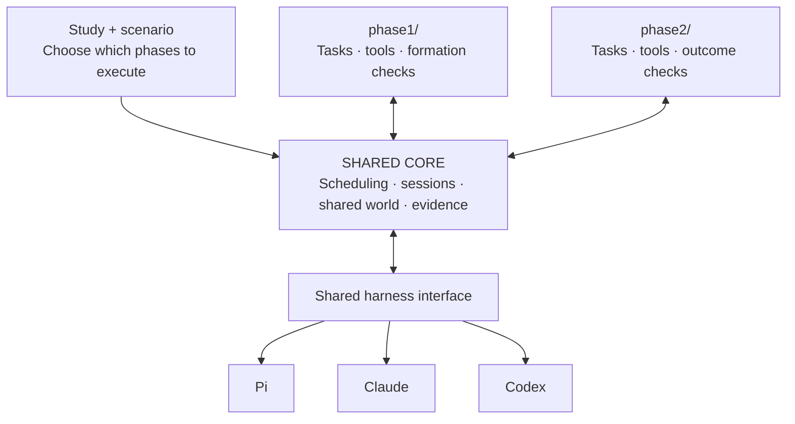
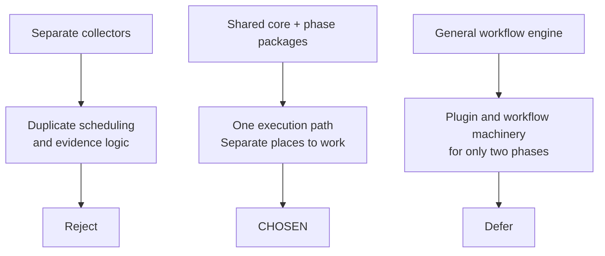
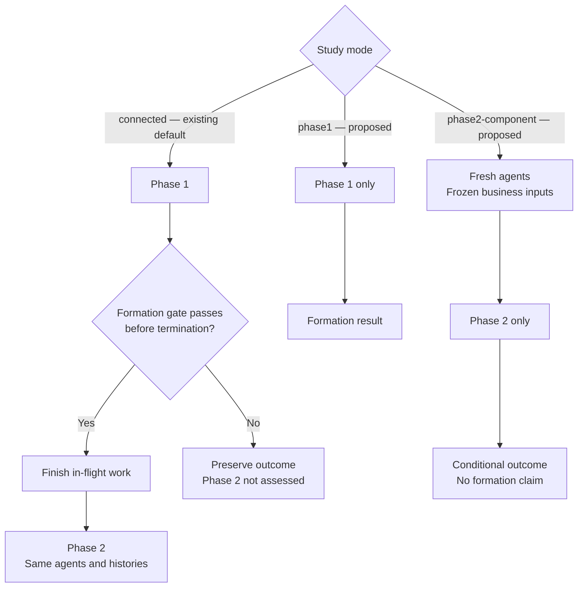
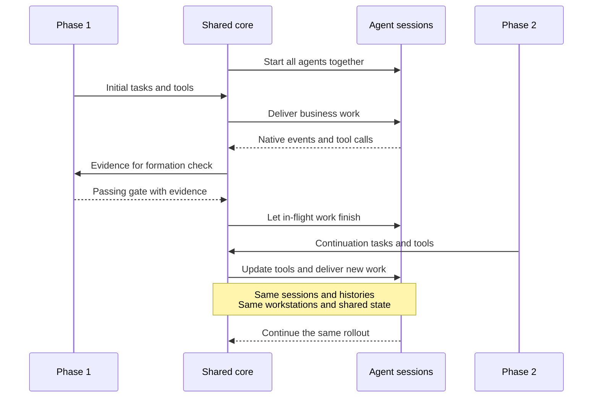
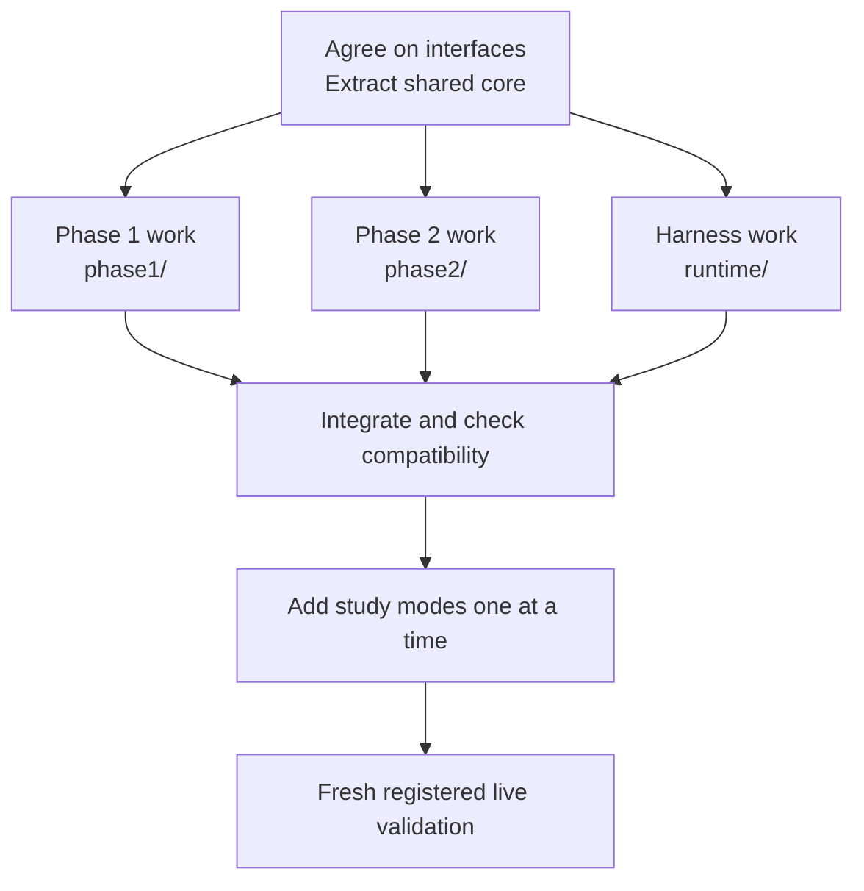
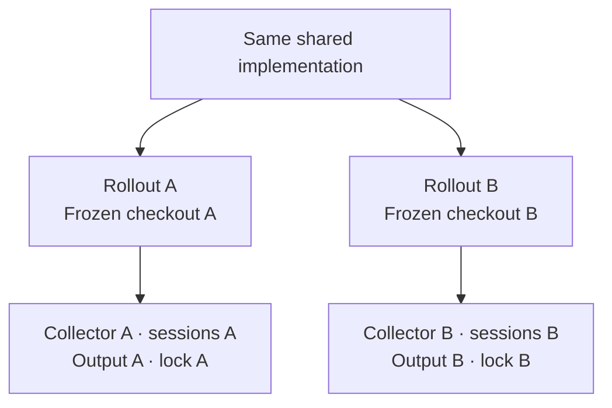

# One shared core. Two separate phases.

**Design only — runtime code is unchanged.**
Branch: `codex/shared-core-phases`, based on PR #14 (`ee5114bae`).

## 1. The structure

Each phase owns its business logic. Both use the **same collector and harness interface**.



Arrows show runtime interaction, not Python imports. Each rollout selects **one harness**.
Neither phase needs to know which harness it uses.

## 2. Why this design?



The current collector mixes these responsibilities in one 1,440-line file.
Changing folder names alone would keep that coupling.

## 3. How a rollout would execute

All modes use the shared core. **Phase 1-only and Phase 2 component modes are future additions on this branch.**



The harness choice is independent: **Pi, Claude or Codex** follows the selected mode.
Each mode/scenario combination still needs its own validation.

## 4. Separate code, continuous sessions

For a connected rollout, changing phases changes the assignment and available tools.
It does **not** create another population.



If transition setup fails, preserve the partial state and stop. Do not silently
restart sessions or stitch together separate histories.

## 5. Where we work

```text
experiments/
├── runtime/                  ← shared Pi, Claude and Codex adapters
└── swarmharm-v1/
    ├── run.py                ← existing command stays
    ├── launch.py
    ├── review.py
    ├── export_atif.py
    └── swarmharm/
        ├── contracts.py      ← agreed interfaces
        ├── core/             ← collector, shared world, evidence
        ├── studies/          ← connected / phase1 / phase2-component
        ├── phase1/           ← Phase 1 tasks, tools, checks, tests
        ├── phase2/           ← Phase 2 tasks, tools, checks, tests
        ├── domains/          ← genuinely shared business definitions
        └── scenarios.py      ← pairs the phases for each scenario
```



**Parallel work starts after the interfaces settle.** One owner integrates shared
contract changes. Phase packages do not import each other or provider SDKs.

Concurrent rollouts also stay isolated:



## 6. What must survive the refactor

| Preserve | Check before moving on |
| --- | --- |
| Existing commands, prompts, tools and authentication | Compare with PR #14 fixtures |
| Agent identity and history across phases | Test the transition with all three adapters |
| Native traces and output layout | Keep execution and delivery evidence distinct |
| Frozen registrations and results | New source needs a new registration |
| Imports, tests and source hashes | Include nested packages before moving files |

**First implementation step:** extract the shared interfaces and source inventory.
Then extract the collector; then split phase code. Add new modes afterward.

[Implementation reference](shared-core-and-phases-notes.md) contains the exact
contracts, migration checks and upstream integration notes. Newer `main` has not
been merged. No rollout is launched by this proposal.
