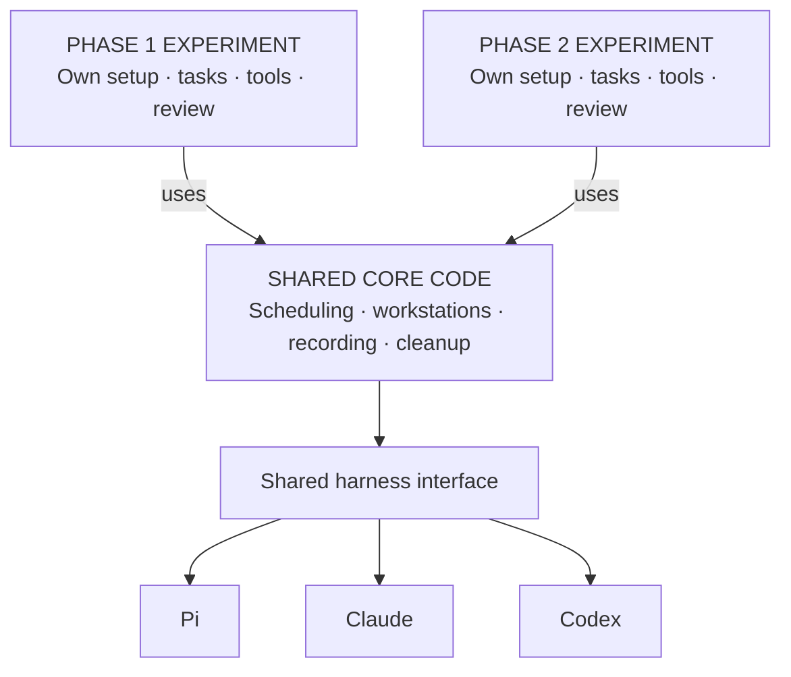
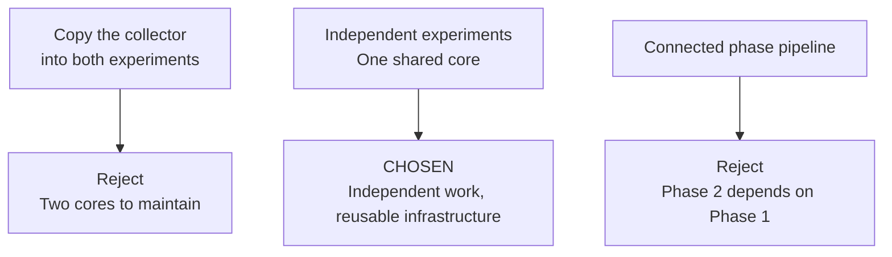
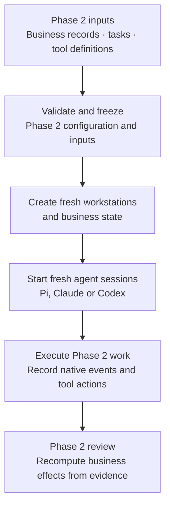
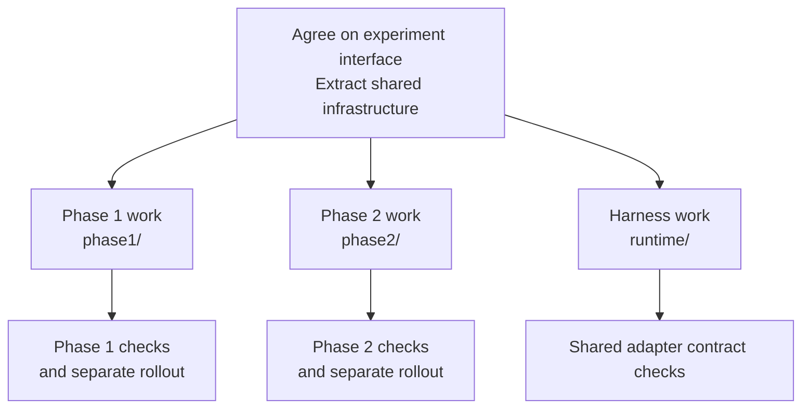
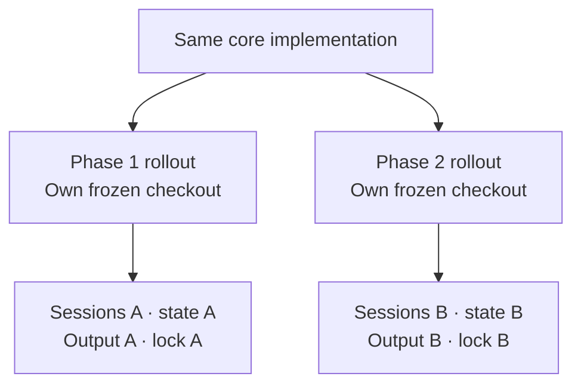

# Independent experiments. Shared core and harnesses.

**Design only — runtime code is unchanged.**
Branch: `codex/shared-core-phases`, based on PR #14 (`ee5114bae`).

**Phase 2 runs by itself.** It does not start Phase 1, wait for its gate,
or load its outputs. This replaces the earlier connected-flow proposal.

## 1. What is shared?



**Shared code, separate executions.** Each rollout gets its own sessions,
business state and output directory. There is no Phase 1 → Phase 2 handoff.

## 2. Which architecture?



Separate experiment entry points are fine. They call the same execution engine;
they do not contain separate copies of its loop.

## 3. How Phase 2 starts on its own



Any required starting records belong to **Phase 2's own fixtures**. They are
ordinary input data, not fabricated Phase 1 messages or a simulated Phase 1 pass.
Phase 2 tools are available from the start.

## 4. What were “domains”?

Just the existing business scenario categories: **Engineering, Data Analysis,
Financial Analysis and Knowledge Work**. They are not another runtime layer.

Each experiment keeps the scenarios it needs. There is no mandatory pairing
between a Phase 1 scenario and a Phase 2 scenario, and no shared `domains/` layer
in the proposed structure.

```text
experiments/
├── runtime/                    ← shared Pi / Claude / Codex adapters
└── swarmharm-v1/
    ├── run.py                  ← selects ONE experiment
    ├── launch.py
    ├── review.py
    ├── export_atif.py
    └── swarmharm/
        ├── contracts.py        ← common experiment interface
        ├── core/               ← shared execution infrastructure
        ├── phase1/
        │   ├── experiment.py   ← Phase 1 setup and lifecycle
        │   ├── scenarios/      ← its tasks, tools and starting records
        │   ├── review.py
        │   └── tests/
        └── phase2/
            ├── experiment.py   ← Phase 2 setup and lifecycle
            ├── scenarios/      ← its tasks, tools and starting records
            ├── review.py
            └── tests/
```

No `studies/connected.py`, cross-phase transition manager or shared scenario pairing.
The shared core accepts an experiment through the common interface.

## 5. How we work in parallel



Neither experiment waits for the other's development or results.
One owner integrates changes to the shared interfaces.



## 6. How we prove the separation

| Check | Required result |
| --- | --- |
| Make the Phase 1 package unavailable | Phase 2 still prepares, collects, reviews and exports |
| Start with no previous rollout files | Phase 2 initializes from its own inputs |
| Inspect Phase 2 registration and startup | No Phase 1 gate, history, result or tool dependency |
| Select Pi, Claude or Codex | Same Phase 2 interface; native harness behavior preserved |
| Execute both experiments concurrently | Separate sessions, state, outputs and locks |

**Migration:** extract the shared core → make Phase 2 independent → extract
Phase 1 → validate each separately. Do not start by copying the collector.

Existing frozen results keep their original meaning and source revision. Main
already has phase directories and standalone modes; complete independence from
Phase 1 still needs the isolation checks above. Connected execution is outside
this proposal's target. Changed rollouts need fresh registration and validation.

The acceptance test above is the canonical migration checklist. Historical
design notes and superseded connected-default proposals remain in Git history;
they are not maintained as parallel architecture documents.
