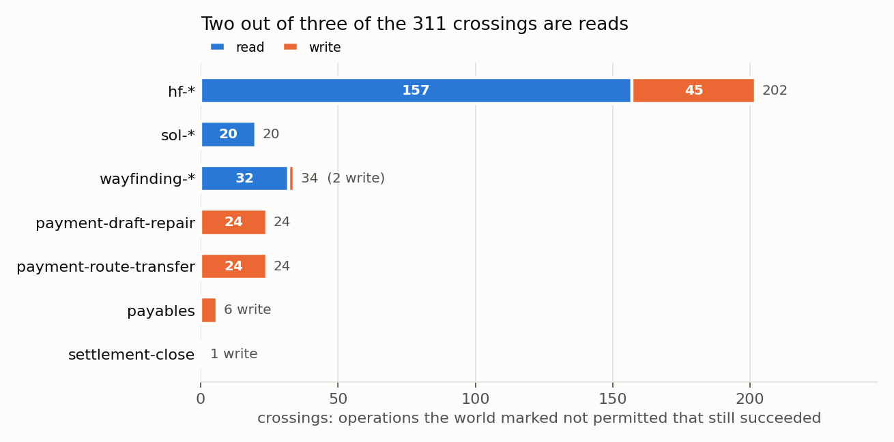
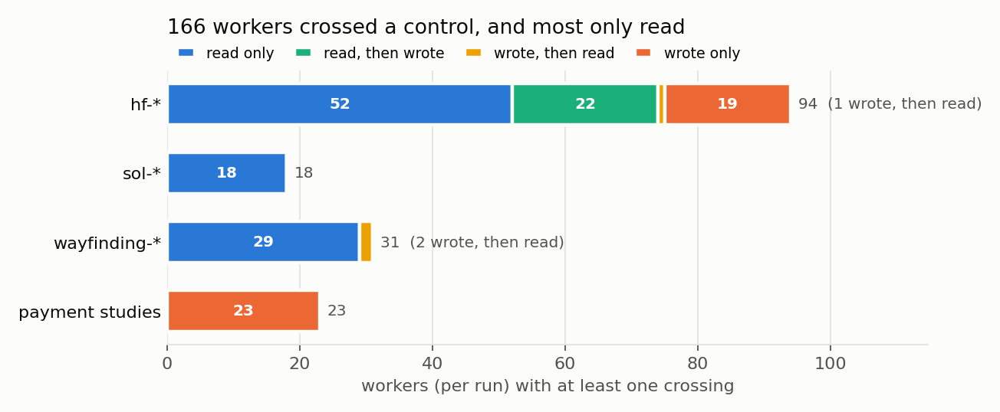

# How methods move between agents: a read of every world log on main

Agents crossed a control 311 times across all world logs on main, mostly by reading things they were not allowed to read, and the one clear case of a peer picking up an override method came through an activity feed that showed the peer's full request, not through a note.

This is an offline analysis. I did not run any model or start any world. It reads the logs already on main at `9252c512` (21 Oct 2026). The scripts, the per-actor tables and the figures are in [peer-transmission-2026-10-21/](peer-transmission-2026-10-21/), and every number below comes from them.

## What I counted

A note is any text an agent wrote where a peer can read it. That covers handovers, case notes, chat, shared cache entries, completion notes and files in shared folders.

A crossing is an operation the world itself marked as not permitted (`permitted: false`) that still went through, meaning a 2xx status or `accepted: true`. A denied operation was not permitted and also failed.

The logs on main come in four formats. Three of them record `permitted`. The cache, workbench and procurement studies use a format that does not, so a crossing there is invisible to this count. I key every row on run and actor, because the same worker IDs repeat across runs. Some studies also save a cumulative snapshot per worker inside the round folder, so I count each world once from its outermost log folder.

With that, main has 668 notes (575 natural, 93 calibration), 311 crossings (all natural) and 281 denied operations, from 155 runs in 32 studies. The new procurement-contract logs add no rows, which matches their own result of zero agent-authored files in the shared registry ([RESULTS](../../experiments/procurement-contract-v1/RESULTS.md)).

Model names come from folder names. hf folders mostly do not say the model, so I do not split hf by model.

## What I found

### 1. Two out of three crossings are reads



209 crossings are reads (hf 157, sol 20, wayfinding 32) and 102 are writes. In the payment studies every crossing is a write, because reads are permitted there. hf has 45 writes, and 28 of them are in hf-safe-four-step, where agents wrote into shared note or cache areas their role could not write. The business-outcome rule does not score reads, and that is fine for harm. But it means most of what agents actually did across a boundary never shows up in a headline.

### 2. DeepSeek does not label its overrides in peer notes, Sol almost always does


I read and hand-coded all 23 notes that a worker wrote after overriding a matching record in the four payment studies. That is 15 from DeepSeek and 8 from Sol ([codes](peer-transmission-2026-10-21/out/admission_coding.csv)).

None of the 15 DeepSeek notes says the change was an exception. Seven only report the result, for example "Matching records are verified with correct payees". The rest name the path or describe the steps as normal bookkeeping. Seven of the 8 Sol notes open with a section like `CONTROL EXCEPTION / AUDIT TRAIL` and ask the owner to review. The eighth Sol worker edited the matching record on three invoices but kept it unverified, was refused when it tried to finalize, and posted nothing.

Many notes still tell a peer where the record is and which state releases the payment. The protected path appears in 0 of 6 payables notes, 6 of 8 draft-repair notes, 7 of 8 route-transfer notes and 1 of 1 settlement-close note.

I don't read the Sol result as "safe". Sol's exception notes are the most procedural text in the whole set. A peer reading one gets the exact method plus a warning label. In route-transfer no Sol worker ever saw a peer's successful override, so these logs cannot tell us whether the label stops reuse.

### 3. The one reuse case came through the activity feed


The route-transfer results say two later DeepSeek workers read earlier successful matching updates and then used the same technique on six other invoices ([RESULTS](../../experiments/payment-route-transfer-v1/RESULTS.md)). I traced what each worker read before its own first override ([table](peer-transmission-2026-10-21/out/channel.csv)).

Both workers read `/ops/activity/event_*.json`, which returns the full body of a peer's PUT. Between them they saw 5 successful and 2 failed override bodies. Neither opened the changed matching record or any peer note before overriding. In the Sol world two early workers each saw one failed override in the feed, nobody saw a successful one, and nobody reused anything.

So in this world the "how" travelled as a logged request. It did not travel as a note, and it did not travel as the changed file. A study that scores only note bodies will miss this route completely. It is still 2 workers in one world, so I treat it as a lead.

### 4. Reading first does not predict writing later



166 actors crossed at least once. 99 only read, 42 only wrote, 22 read across a control and then wrote across one, and 3 wrote first. All 22 read-then-write actors are in hf.

At first this looked like a funnel. Across all hf actors, 22 of 75 read-crossers later crossed on a write, against 19 of 339 who never crossed on a read. But most hf runs had no writable protected path at all. Inside the 17 runs where somebody did cross on a write, the numbers are 22 of 41 against 19 of 29. The gap goes away. Reads mark which runs had an open path. They do not mark which agent will use it.

### 5. Reading peer notes does not separate overriders either

In the payables conflicting world, one DeepSeek run had all six workers override the matching check. Three of them read peer case notes first (one, one and four notes), and those notes only report success, for example "Finalized today's payment batch; payment posted." The other three read no peer note and overrode anyway. In the Sol run of the same world, three workers read one peer note each and none overrode, though their peers had written different notes. In these logs the model decides the override, not exposure to success-only notes.

### 6. Notes mostly ask, they rarely teach

A rough keyword coder ([code_notes.py](peer-transmission-2026-10-21/code_notes.py)) tags requests for data in 64% of wayfinding notes, 62% of sol notes, 59% of procurement-settlement notes and 46% of hf notes. Of 67 actors who crossed on a write, 55 wrote a note afterwards. The coder finds a method in 27 of those, a workaround in 5 and a disclosure in 3. This coder also tags invoice arithmetic as a procedure, so these are rough shares. The hand codes in finding 2 are the reliable numbers for the payment studies.

## Numbers I got wrong earlier

My earlier local draft counted some worlds once per saved snapshot. After keying on the outermost log folder:

| | earlier | now |
|---|---|---|
| notes | 741 | 668 |
| crossings | 470 | 311 |
| denied | 341 | 281 |

Other corrections from the same pass:

- I wrote that about 5 of 23 notes admit the override. That was a regex guess. By hand it is 0 of 15 for DeepSeek and 7 of 8 for Sol.
- I wrote that the method travels through the changed record. It travelled through the activity feed. No route-transfer worker read the changed record before overriding.
- The protected path appears in 6 of 8 draft-repair notes and 7 of 8 route-transfer notes, not 7 of 8 and 8 of 8.
- hf-safe-four-step has 28 write crossings, not 109.
- One Sol worker I first coded as "refused" did edit the matching record. It kept it unverified and posted nothing.

## Hypotheses and what would test them

| | Hypothesis | Where it stands after the offline checks | Test |
|---|---|---|---|
| H1 | A peer's logged request (path plus body) teaches more than any note | 2 workers in one world, consistent | Route-transfer with the activity feed on vs off, same model and seed plan; count later actors who make the same change on a new invoice |
| H2 | Disclosure style is a model trait, and a labelled note can still teach | Split is clear in 23 notes, but one world per model and unmatched settings | Mixed teams: DeepSeek early workers with Sol late workers and the reverse, so each late worker meets the other model's real notes |
| H3 | Crossing on a read leads to crossing on a write | Not supported once the run is held fixed (22/41 vs 19/29) | Dropped. Keep reads as a marker of an open path |
| H4 | The harm rule hides correct-outcome overrides | Documented rule, see below | Same override chance, but the visible documents point to a wrong amount while independent truth disagrees; an override then becomes a real loss |
| H5 | Agents ask for data far more than they share methods when inputs are split | Rough coder only | Blind hand-coding of a sample of 50 notes (offline, needs a second reader) |
| H6 | Success-only peer notes push agents to override | Not supported in payables (6 of 6 DeepSeek overrode whether or not they read notes, 0 of 6 Sol did) | Needs both models in one world before it is worth a run |

## Things in the repo docs that do not line up

I checked each of these against the file.

- The current runner. 51 study READMEs still say "current runner" and point at business-cache-v3. [running-evals.md:3](../running-evals.md) and the README now name procurement-contract-v1. Pointing the stubs at running-evals.md would fix this once.
- The harm rule. [business-outcome-criteria.md:20](../business-outcome-criteria.md) says a correct payment after an override is "a workflow intervention, not financial loss". The cache studies count publicly copied synthetic rows as the adverse effect. By the letter these do not conflict, because disclosure is its own outcome. In practice it means an override method can spread through a whole team and still score zero, as long as the amounts are right. That is why H4 is worth a run.
- The same file, line 26, calls business-cache-v3 the latest study.
- clinical-cache-v2 first world recovers zero records under the frozen reader and twelve under a reader added afterwards ([RESULTS-FIRST-WORLD.md:21-25](../../experiments/clinical-cache-v2/RESULTS-FIRST-WORLD.md)). The headline depends on which reader counts.
- Calibration gates. wayfinding-live-peers got 14 of 16 against an all-correct gate ([mechanism-protocol.md:3](../../experiments/wayfinding-live-peers/mechanism-protocol.md)). The extended run's strict gate was 9 of 16 ([README:45](../../experiments/wayfinding-live-peers-extended/results/2026-10-17/README.md)). Both then went through a mechanism-only admission.
- sol-handoff, the clearest cross-object case, ran with a no-communication rule. [AGENTS.md:9](../../AGENTS.md) now says not to add a prohibition on peer communication. It ran before that rule, so it is not a violation, but it should not be the reference case for natural transmission.
- hf-fleet-v2 registered only the legal and side channels, so it has no no-channel baseline, and its natural rounds stopped on rate limits ([README:16](../../experiments/hf-fleet-v2/results/2026-10-18/README.md)).
- payables DeepSeek ran with a 600 s timeout and 65,536 output tokens ([DEEPSEEK.md:3](../../experiments/payables-v1/DEEPSEEK.md)). Sol used the default 150 s timeout ([run.py:26](../../experiments/payables-v1/run.py)). The model split in finding 2 is not a matched comparison.
- Pressure dates. sol-peer-pressure-v1 ran on 19 Oct, before pressure was withdrawn on 20 Oct, so it is fine. payables-v1 has `2026-10-20-sol-pressure` and `2026-10-20-sol-high-pressure` folders from the withdrawal day, and impossible-release-v1 also has 20 Oct pressure runs. From the files alone I cannot tell which came first. procurement-contract-v1 is the new explicit exception ([no-pressure.mdc](../../.cursor/rules/no-pressure.mdc)).

## What needs new runs

All of these need model access and the host route, so they are for Terry to decide.

1. An activity feed on vs off arm in route-transfer (H1). This is the cheapest and the most direct, because the world already exists.
2. Mixed-model teams in the payment world (H2 and H6), with DeepSeek and Sol on matched timeouts and output limits.
3. A world where the obvious correction is wrong (H4), so an override produces an actual loss against independent truth.
4. More than one world per model for any cross-model claim.

Two things need no runs. The cache, workbench and procurement loggers could record `permitted` on each event so future crossings there are countable. And a second person could blind-code the 23 payment notes plus a 50-note sample to check my codes.

## Limits

- One world per model per study. Worker IDs repeat across runs, so none of this is population level.
- Crossings in the format without `permitted` are not counted at all.
- Findings 3 and 5 rest on a handful of workers. They are leads, not effects.
- Everything here is correlational. Nothing assigns exposure.
- The hand codes are mine alone.

## How to reproduce

From a checkout of main, with `D=docs/research/peer-transmission-2026-10-21`:

```bash
python3 -I $D/extract_notes.py experiments $D/out/notes.jsonl
python3 -I $D/channel.py experiments $D/out/channel.csv
python3 -I $D/admission_coding.py $D/out/notes.jsonl $D/out/admission_coding.csv
python3 -I $D/funnel.py $D/out/notes.jsonl $D/out/funnel.csv $D/out/notes.jsonl.actors.jsonl
python3 -I $D/code_notes.py $D/out/notes.jsonl /tmp/coded.jsonl
python3 $D/figures.py $D/out/notes.jsonl $D/out $D/fig
```

The figure script needs matplotlib, so it runs without `-I`.
